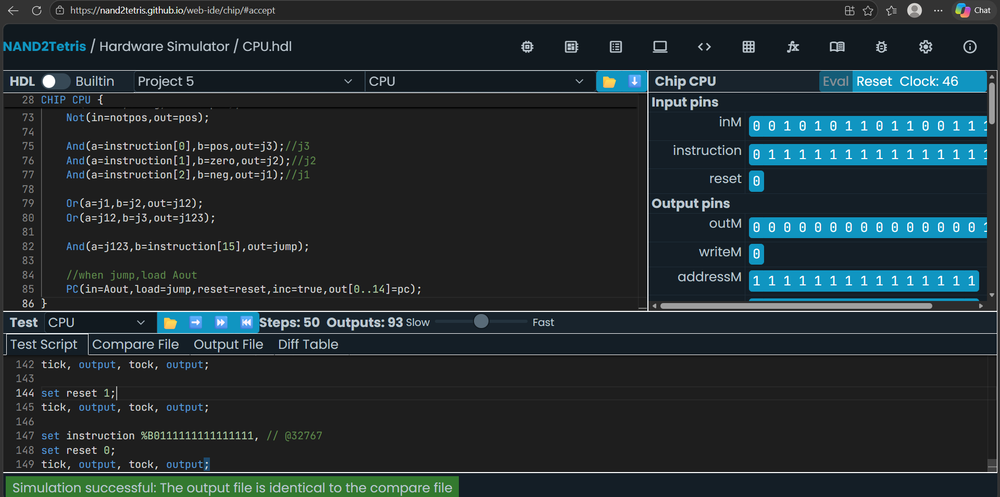
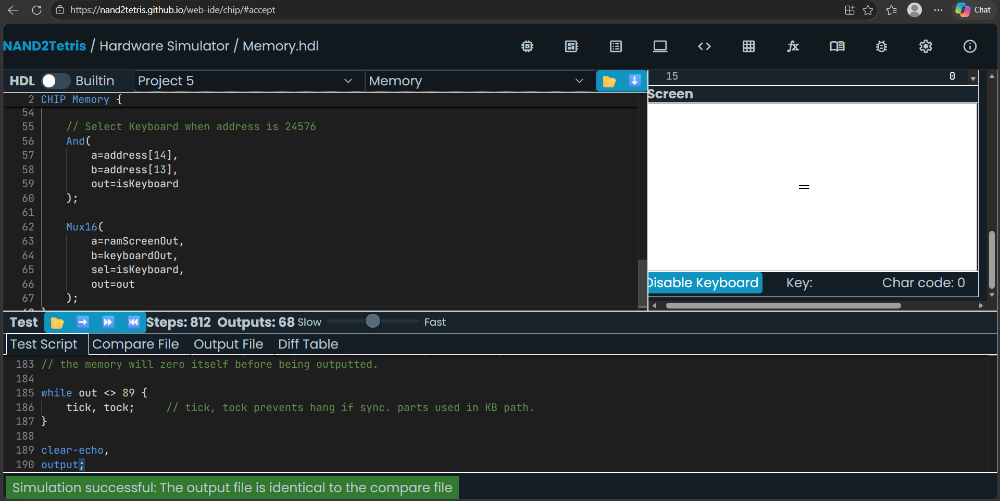
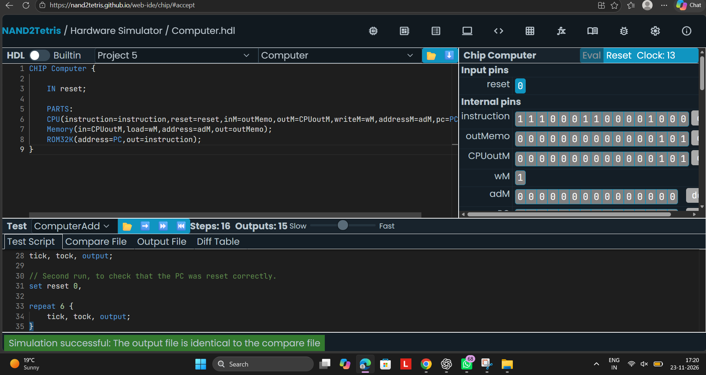
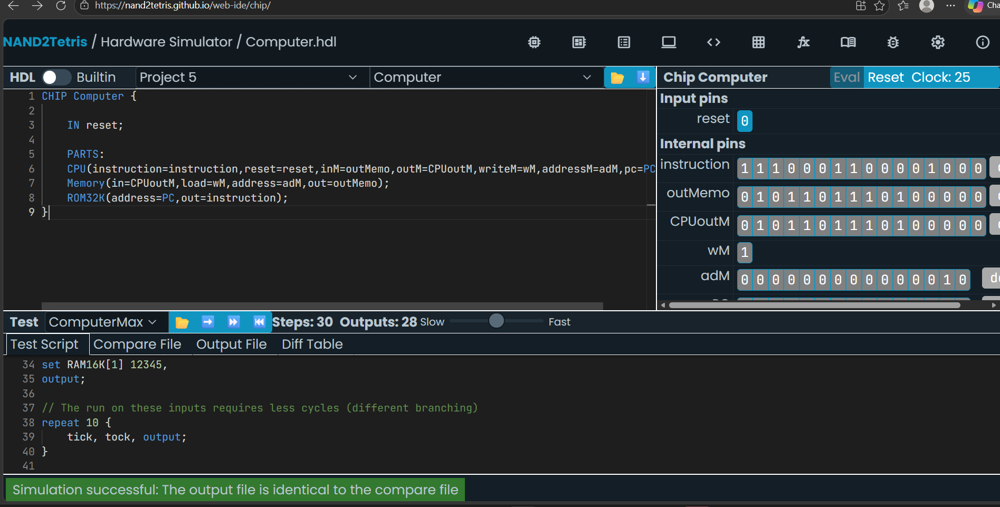

# Nand2Tetris – Building a Computer from First Principles

A complete implementation of the Hack computer from the **Nand2Tetris** course: starting from a single NAND gate, this project builds every chip of the computer in HDL, writes an assembler for the Hack machine language in Python, and finishes with an interactive assembly program that draws on the screen.

| | |
|---|---|
| **Name** | Shree Vashist |
| **Roll No.** | 2501730459 |
| **Programme** | B.Tech CSE (AI/ML) |
| **Section** | G |

---

## Repository Structure

```
Nand2Tetris-Repository/
├── Part_A_Computer/      # 27 HDL chips: logic gates → ALU → RAM → CPU → Computer
├── Part_B_Assembler/     # Hack assembler (Python) + sample .asm / .hack programs
├── Part_C_Box/           # Box.asm / Box.hack – keyboard-controlled box on screen
└── Screenshots/          # Simulator and terminal screenshots of passing tests
```

---

## Part A – The Computer (HDL)

All chips are written in the Nand2Tetris Hardware Description Language and were tested in the [Nand2Tetris Web IDE](https://nand2tetris.github.io/web-ide/chip/).

| Level | Chips |
|---|---|
| Basic logic | `Not`, `And`, `Or`, `Xor`, `Mux`, `DMux`, `Mux16`, `DMux4Way`, `DMux8Way` |
| Arithmetic | `HalfAdder`, `FullAdder`, `Add16`, `Inc16`, `ALU` |
| Sequential | `Bit`, `Register`, `ARegister`, `DRegister`, `PC` |
| Memory | `RAM8`, `RAM64`, `RAM512`, `RAM4K`, `RAM16K`, `Memory` |
| Computer | `CPU`, `Computer` |

**Highlights**

- **ALU** – built from `Mux16`, `Not16`, `And16` and `Add16`; computes all 18 Hack functions and outputs the `zr` (zero) and `ng` (negative) flags.
- **CPU** – decodes the 16-bit Hack instruction, drives the A and D registers, the ALU, `writeM`, and the jump logic for the program counter.
- **Memory** – maps 16K RAM (`0–16383`), the screen (`16384–24575`) and the keyboard (`24576`) into one address space.
- **Computer** – connects `CPU`, `Memory` and `ROM32K`.

## Part B – The Assembler (`assembler.py`)

A two-pass assembler that translates Hack assembly (`.asm`) into 16-bit binary machine code (`.hack`).

- **Pass 1** – records every `(LABEL)` with its ROM address.
- **Pass 2** – translates A-instructions and C-instructions, allocating variables from RAM address 16 onward.
- Supports predefined symbols (`SP`, `LCL`, `ARG`, `THIS`, `THAT`, `R0–R15`, `SCREEN`, `KBD`).
- Reports errors with line numbers (invalid instruction, invalid/duplicate label, address out of range).

### Usage

Requires Python 3.

```bash
python Part_B_Assembler/assembler.py Part_B_Assembler/Add.asm
```

Output (the `.hack` file is written next to the input file):

```
Assembly successful!
Input: Part_B_Assembler/Add.asm
Output: Part_B_Assembler/Add.hack
Instructions generated: 6
```

### Programs assembled

| Program | Description | Instructions |
|---|---|---|
| `Add.asm` | Computes 2 + 3 and stores it in `RAM[0]` | 6 |
| `Max.asm` | `RAM[2] = max(RAM[0], RAM[1])` | 16 |
| `Rect.asm` | Draws a 16-pixel-wide rectangle, `R0` rows high | 25 |
| `Pong.asm` | The full Pong game (large stress test) | 27,483 |
| `Invalid.asm` | Deliberately wrong – exits with `Line 3: Invalid instruction` | – |

## Part C – Box Program

`Part_C_Box/Box.asm` draws a **32 × 20 pixel box** starting at screen row 49 (address `17952`). The box is **black while any key is pressed** and **white otherwise**, re-checking the keyboard continuously.

To run it: assemble `Box.asm` (or load `Box.hack`) in the Web IDE CPU Emulator, load it into ROM, and press a key.

---

## How to Test

1. Open the [Nand2Tetris Web IDE](https://nand2tetris.github.io/web-ide/).
2. Load a chip from `Part_A_Computer/` and run its provided test script / compare file.
3. For `Computer`, load `Add.hack`, `Max.hack` or `Rect.hack` into ROM and run `ComputerAdd`, `ComputerMax` or `ComputerRect`.

## Test Results

All tests ran with **"Simulation successful: The output file is identical to the compare file"**.

| Test | Steps |
|---|---|
| `CPU` | 50 |
| `Memory` | 812 |
| `Computer` – `ComputerAdd` | 16 |
| `Computer` – `ComputerMax` | 30 |
| `Computer` – `ComputerRect` | 69 |






## What I Learned

- How simple gates compose into arithmetic, memory and finally a full CPU.
- How machine language relates to assembly, and how an assembler resolves labels and variables.
- How memory-mapped I/O lets a program draw pixels and read the keyboard with ordinary reads and writes.

## Reference

Nisan, N. and Schocken, S., *The Elements of Computing Systems*, 2nd ed., MIT Press, 2021 – [nand2tetris.org](https://www.nand2tetris.org)